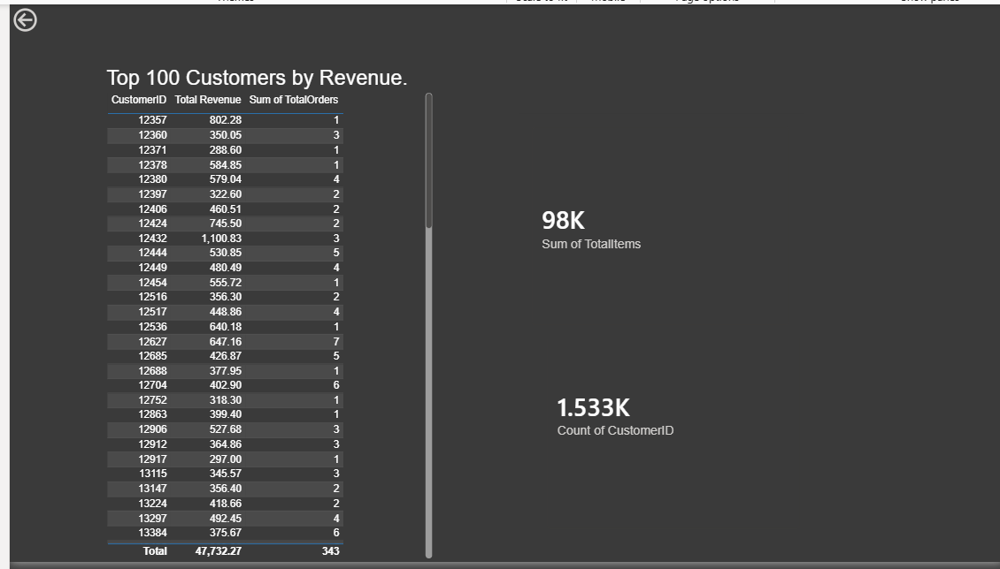

# AI Marketing Intelligence System

An Astana IT University team project by **Tair Asset** and **Alinur Sabit** for AI for Marketing Decisions. The project uses online retail transactions to explore purchasing patterns, segment customers, and test ways to prioritize retention and recommendations.

## Preview

- [Analysis notebook](./notebook/Final_exam_marketing_Asset_T_Sabit_A.ipynb) with code, charts, and interpretation.
- [Project presentation](./AI_Marketing_Intelligence_System_Final_Exam.pptx) with the analysis workflow and findings.
- [Power BI report](./Marketing%20Final%20Tair%20Asset%20Alinur%20Sabit%20AIB-2401.pbix) for Power BI Desktop.
- [Processed data](./data/) with cleaned transactions, customer features, and sentiment counts.

## Analysis workflow

1. Clean transactions and derive customer-level measures such as order frequency and average order value.
2. Profile purchasing patterns and group customers using K-means.
3. Compare logistic regression, random forest, and XGBoost on a customer inactivity label.
4. Rank product recommendations using customer similarity.
5. Explore sentiment on a separate Twitter dataset with TextBlob.

## Reproduce the notebook

Open the notebook in Google Colab, add `KAGGLE_USERNAME` and `KAGGLE_KEY` as Colab secrets, and grant the notebook access to them. Run the setup cells, then run the remaining cells in order. The notebook retrieves a Kaggle copy of [UCI Online Retail](https://archive.ics.uci.edu/dataset/352/online+retail) and the [Twitter Entity Sentiment Analysis dataset](https://www.kaggle.com/datasets/jp797498e/twitter-entity-sentiment-analysis).

The UCI source contains 541,909 transaction records. The notebook cleans it and caps the working sample at 50,000 rows. It defines inactivity as over 90 days since the last purchase at the dataset reference date and compares models with a random customer split. Evaluating future churn would require a time-based split and observed outcomes after the cutoff.
